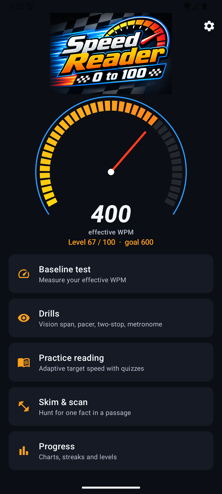
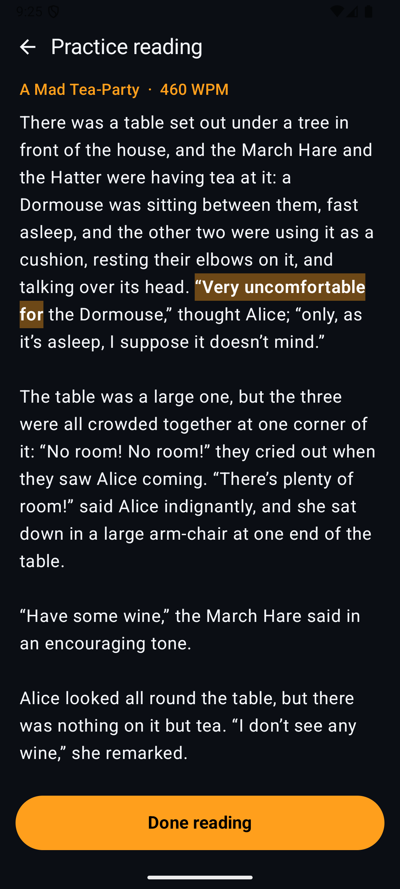
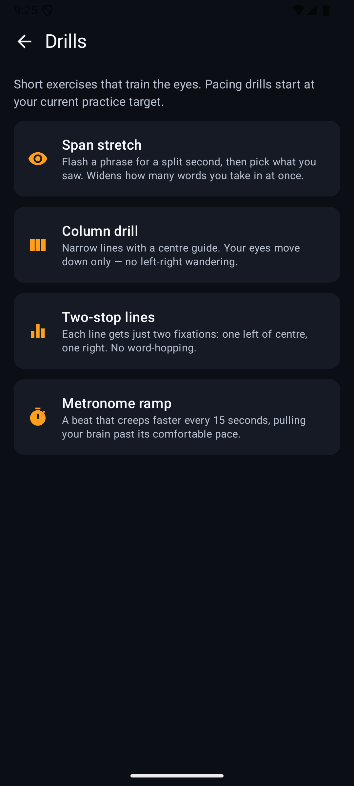
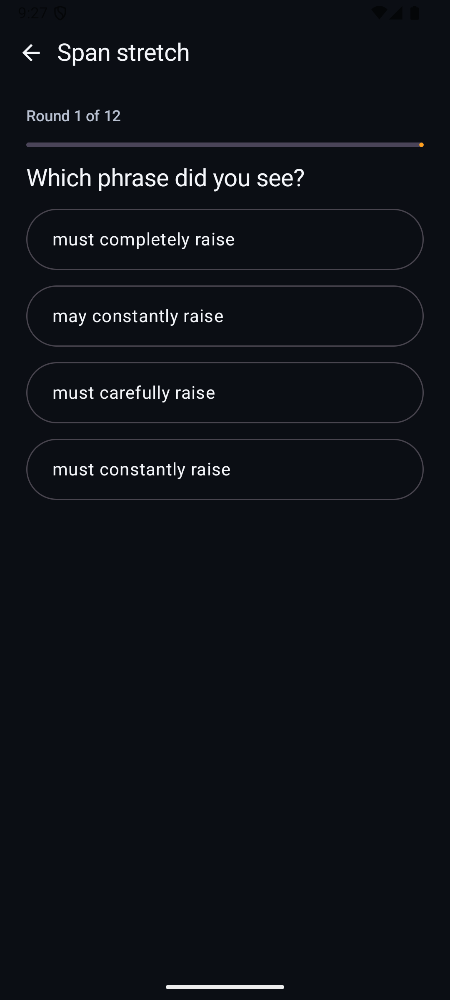
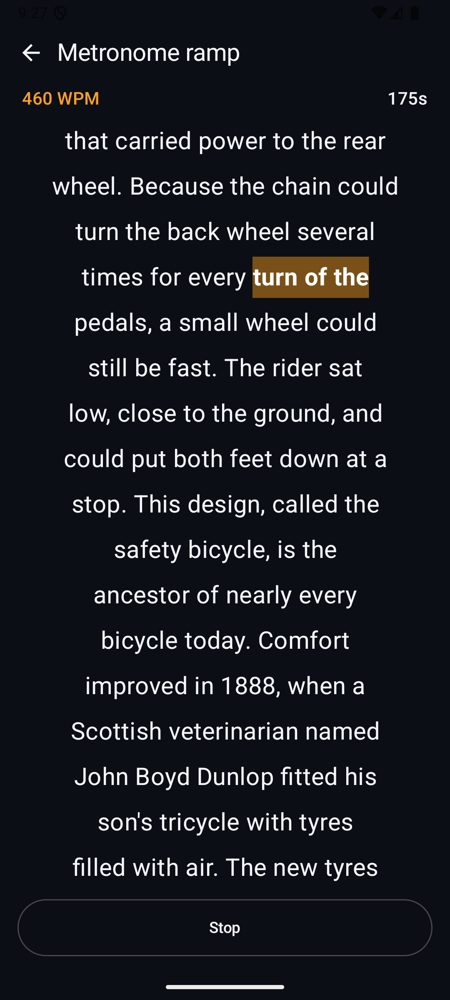
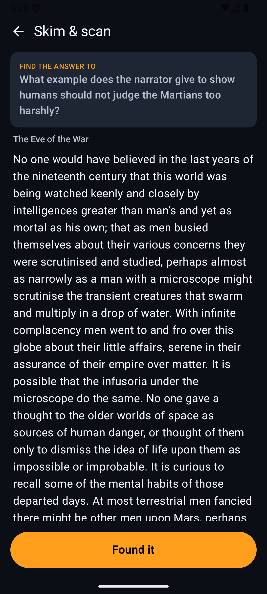
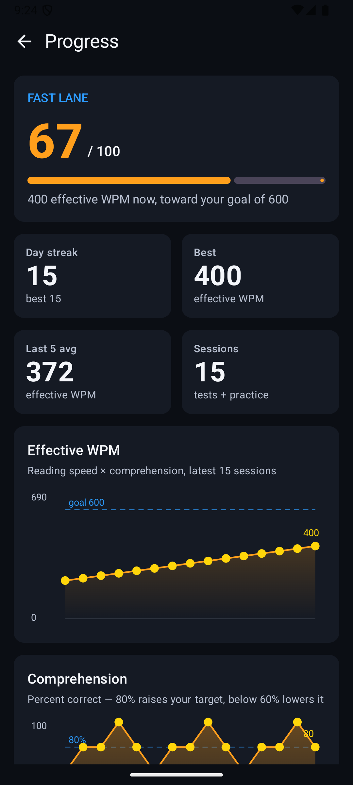
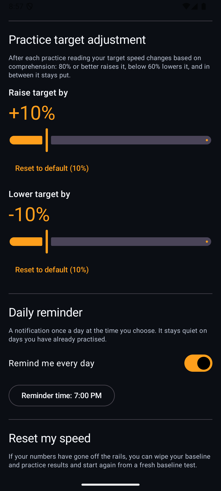
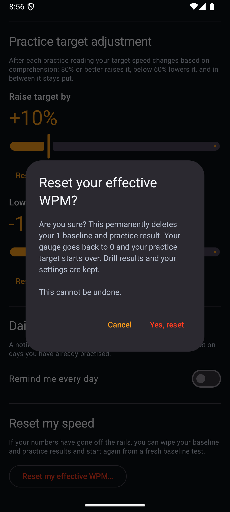

# Speed Reader: 0 to 100

An Android app for becoming a faster reader without losing comprehension. It is a personal project, built from the ideas in three speed-reading books (Cutler, Buzan and Nandy) and measured the way they recommend: **effective WPM = raw WPM × comprehension**. Reading fast and understanding nothing doesn't count.

Your **level (0–100)** is your effective WPM as a share of your goal. The goal is 600 by default and can be changed in Settings.

| | |
|---|---|
|  | **Home.** The racing gauge shows your latest effective WPM and level, with shortcuts to every mode. |

## Features

### Baseline test and practice reading
Read a passage, take a five-question quiz, and get your effective WPM. **Practice reading** then paces you through public-domain excerpts at a target speed. The target adapts: 80% comprehension or better raises it, below 60% lowers it, and in between it holds. The raise and lower percentages (10% by default) are set in Settings. A speed guard ignores results above 1,500 WPM, which means you skimmed rather than read.



The highlighted pacer moves at a fixed schedule, so you can't drift behind it.

### Drills
Short exercises that train the eye habits the books blame for slow reading.



- **Span stretch** flashes a phrase and asks what you saw, which widens how much you take in at a glance.
- **Column drill** uses narrow lines with a centre guide, so your eyes move down only.
- **Two-stop lines** gives each line just two fixations.
- **Metronome ramp** is a pacer that speeds up by 25 WPM every 15 seconds, pulling you past your comfortable pace.

| Span stretch | Metronome ramp |
|---|---|
|  |  |

### Skim & scan
You get a question first, then a passage. Sweep the text, tap **Found it** when you spot the answer, then pick it from four choices. Scan speed only counts when you're right. Afterwards, **Show where the answer was** highlights the sentence.



### Progress
Level and title, day streak, best and last-five averages, charts of effective WPM against your goal and of comprehension, plus your best drill results and recent activity.



### Daily reminder and reset (Settings)
- **Daily reminder:** off by default, at a time you choose. It stays quiet on days you've already practised, and the message mentions your streak.
- **Reset my effective WPM:** wipes your baseline and practice results if your numbers have gone off the rails. It always asks first, and drill results and settings are kept.

| Reminder | Reset confirmation |
|---|---|
|  |  |

The app has an adaptive launcher icon with a themed (monochrome) variant.

> The screenshots show sample data seeded into an emulator, not real results.

## Content
- 66 excerpts (40 fiction, 26 non-fiction) from Project Gutenberg's most-downloaded titles, each with five comprehension questions.
- 367 skim & scan questions with evidence sentences.
- All questions are original. Only public-domain text is bundled.

## Tech
Kotlin, Jetpack Compose (Material 3), MVVM with ViewModels and StateFlow, Hilt, Room (progress and drill results) and DataStore (settings). minSdk 36, one `app` module, package `com.scttech.android.kotlin.speedreader`.

## Build and test
Open the project in Android Studio, or from the command line:

```
./gradlew :app:assembleDebug
./gradlew :app:testDebugUnitTest
```

The unit tests cover the adaptive target, scoring, progress statistics, the reminder logic and the reset flow. They also guard the content: answer positions balanced, answer length not a giveaway, and every scan question's evidence found in its text.

## Rebuilding the excerpts
The excerpt JSON in `app/src/main/assets/excerpts/` is generated by the Python scripts in `tools/` from the source texts in `project_assets/source_texts`:

```
python3 tools/build_excerpts.py --strict
```

See [APPROACH.md](APPROACH.md) for the training principles, milestones and content workflow.
